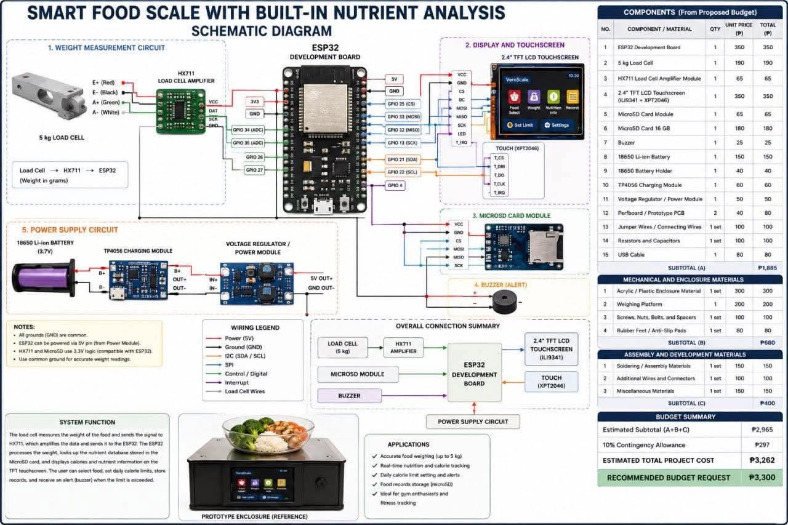

# veroscale

## 📷 Preview 

 

# The Veroscale Prototype is a proposed system designed to provide a simple, efficient, and user-friendly way to measure, monitor, and manage information related to scale or measurement processes. The prototype aims to demonstrate how the system works, showcase its main features, and evaluate its functionality before developing the final version. It serves as an initial model for testing the design, usability, accuracy, and overall performance of the system.

If you tell me what Veroscale is specifically (for example, a digital weighing scale, an inventory system, or a software application), I can make the description more accurate and suitable for your project documentation.

